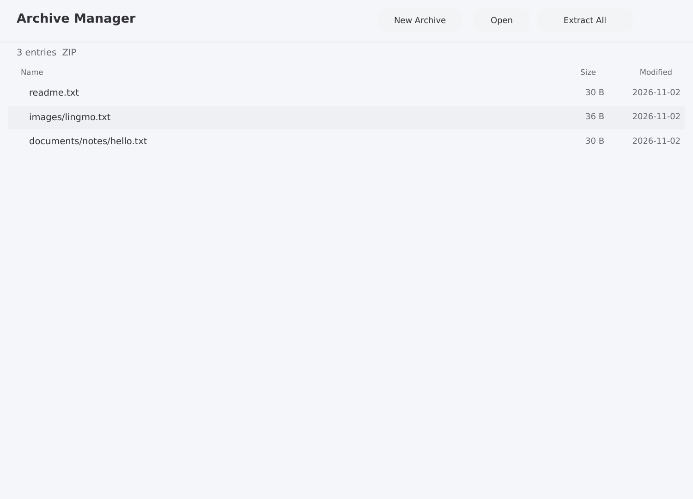
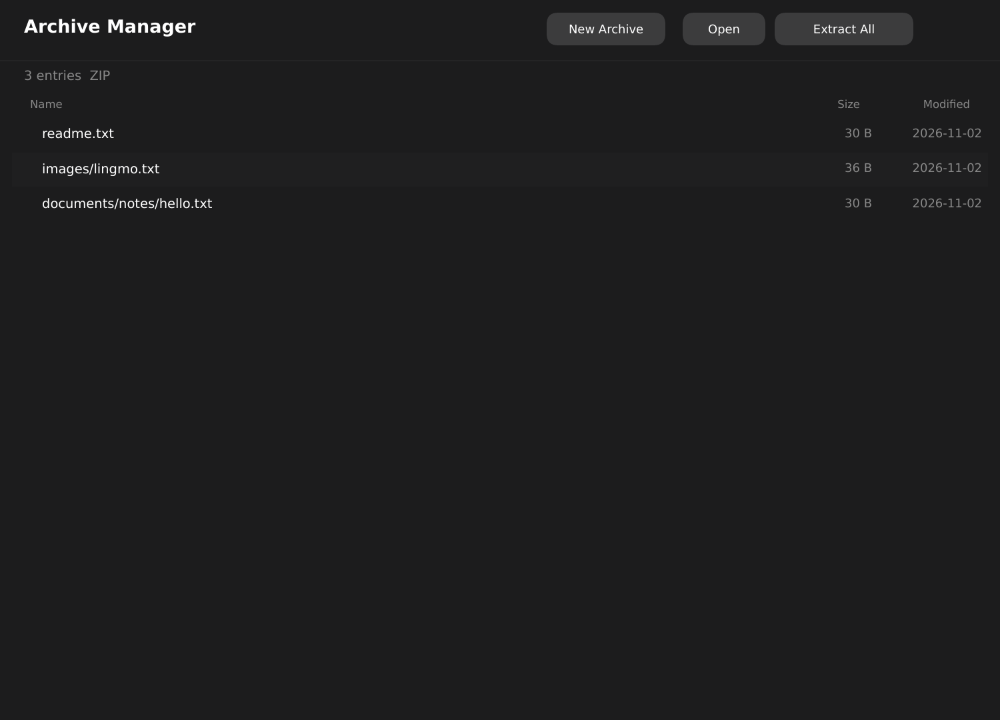

# lingmo-archive-manager

A native archive manager for Lingmo OS, based on libarchive.

## Features

- Open zip, tar, tar.gz, 7z and rar archives.
- Select entries and extract them, or extract everything, to a folder you choose.
- Create a new ZIP, TAR or TAR.GZ from a folder.
- Light and dark themes.

## Build

```sh
cmake -S . -B build -DCMAKE_PREFIX_PATH=/path/to/lingmo-sdk
cmake --build build
sudo cmake --install build
```

## Screenshots



